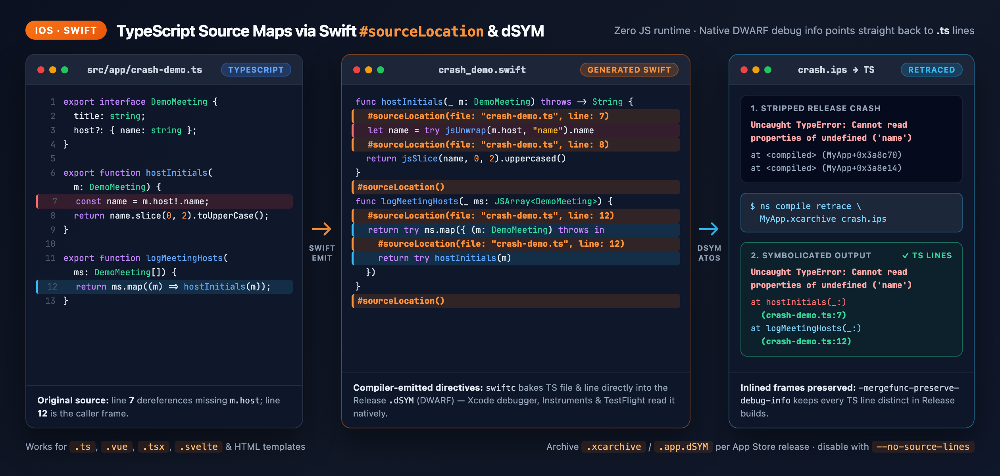
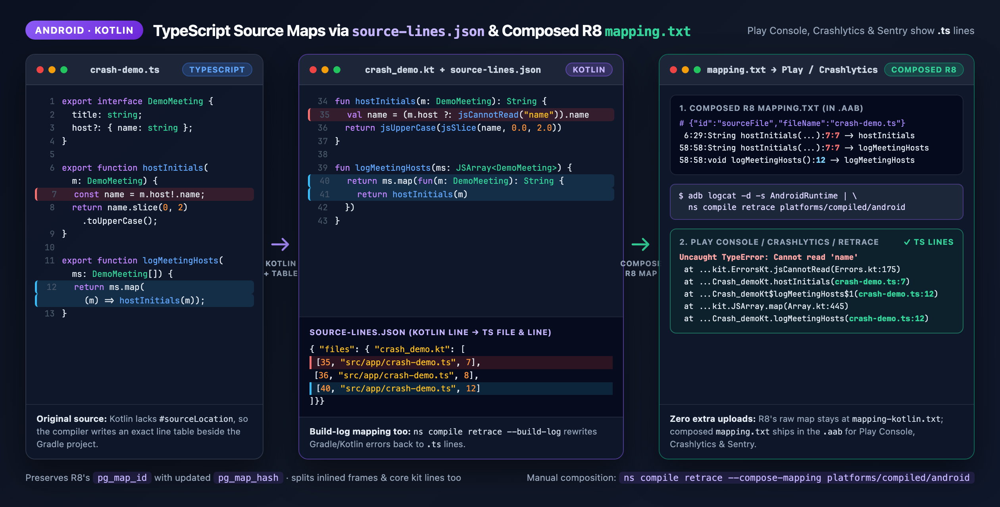

# @nstudio/nativescript-compiler

Official nStudio NativeScript CLI plugin (`ns compile`) and framework adapters that compile NativeScript apps (TypeScript, `@nativescript/core`, framework templates, and plugins) directly to native **Swift** (iOS) and **Kotlin** (Android) — with **no JavaScript runtime** in the release binary.

[Packages](#packages) · [Quick Start](#quick-start-end-users) · [Examples](#examples) · [Crash Traces](#crash-traces) · [Speed & Footprint](#speed-and-footprint-compiled-vs-js-v8-release) · [Local Development](#local-development) · [Generating Kits](#generating-swift--kotlin-kits-from-nativescriptcore)

---

## Packages

| Package | Path | Description |
| --- | --- | --- |
| `@nstudio/nativescript-compiler` | `packages/compiler` | CLI extension (`ns compile ios\|android\|verify\|retrace\|doctor`), Swift/Kotlin compiler, runtime kits, and public APIs (`adapter-api`, `binding-api`, `config`) |
| `@nstudio/nativescript-compiler-angular` | `packages/angular` | Angular 22 adapter (templates, signals, DI, routing, forms) |
| `@nstudio/nativescript-compiler-vue` | `packages/vue` | Vue 3 SFC adapter (`<script setup>`, reactivity, slots) |
| `@nstudio/nativescript-compiler-svelte` | `packages/svelte` | Svelte 4 & Svelte 5 runes adapter |
| `@nstudio/nativescript-compiler-react` | `packages/react` | React TSX adapter (hooks, reconciler) |
| `@nstudio/nativescript-compiler-solid` | `packages/solid` | Solid JSX adapter (signals, effects, control flow) |
| `@nstudio/nativescript-compiler-octane` | `packages/octane` | Octane adapter |
| `@nstudio/nativescript-compiler-stubs-nativescript-ui` | `packages/stubs-nativescript-ui` | Optional no-op stand-ins for closed-source `nativescript-ui-*` plugins (`private`) |
| `@triniwiz/compiled-nativescript-canvas` | `packages/nativescript-canvas` | Native Swift & Kotlin/JNI binding package for `@nativescript/canvas` (`private`) |

## Quick Start (End Users)

```sh
# 1. Install the NativeScript CLI extension (npm install -g nativescript@next, nativescript CLI >= 9.2.0 / PR #6215)
ns extension install @nstudio/nativescript-compiler

# 2. (Framework apps only) Install the matching adapter in your project
npm install --save-dev @nstudio/nativescript-compiler-angular

# 3. Check environment, kits, core version, and plugins
ns compile doctor

# 4. Build and run native Swift (iOS) or Kotlin (Android) releases
ns compile ios --run
ns compile android --run
```

For `nativescript.config.ts` autocompletion on `release`, `ios.release`, and `android.release`:

```ts
import { NativeScriptConfig } from '@nativescript/core';
import '@nstudio/nativescript-compiler/config';
```

## Examples

Apps built with NativeScript and compiled directly to native Swift and Kotlin (with no JavaScript runtime) shipping on the App Store and Google Play:

| App | iOS | Android |
| --- | --- | --- |
| **OpenJS Foundation** | [App Store](https://apps.apple.com/us/app/openjs-foundation/id6792399541) | [Google Play](https://play.google.com/store/apps/details?id=org.openjsf.app) |
| **Guitar Pocketbook** | [App Store](https://apps.apple.com/us/app/guitar-pocketbook/id6814297918) | [Google Play](https://play.google.com/store/apps/details?id=io.nstudio.guitarpocketbook) |

## Crash Traces

Even though compiled releases ship **no JavaScript runtime**, every translated statement still maps back to the exact `.ts`, `.vue`, `.tsx`, `.svelte`, or HTML template file and line it came from (`--no-source-lines` disables emission). Release crash traces — in Xcode/Instruments, TestFlight `.ips` reports, Google Play Console, Firebase Crashlytics, and Sentry — resolve directly back to your original TypeScript source lines.

### iOS (Swift `#sourceLocation` & `.dSYM`)



<details>
<summary><strong>How iOS TypeScript source mapping &amp; symbolication work</strong></summary>

1. **Compiler-emitted `#sourceLocation` directives:** Every translated statement in generated `.swift` files is preceded by `#sourceLocation(file: "<path>", line: <n>)` (and reset with `#sourceLocation()` around compiler-synthesized glue). `swiftc` bakes those TypeScript paths and line numbers directly into the Release `.dSYM` (DWARF debug info), so Xcode's debugger, Instruments, `fatalError`, and TestFlight crash logs report `.ts` files and lines natively.
2. **Inlined frames preserved in Release builds:** Release Swift builds pass `-Xllvm -mergefunc-preserve-debug-info` so LLVM's function-merging pass does not collapse near-identical functions onto a single misleading line number.
3. **Retracing stripped store crashes:** A stripped App Store binary logs frames as `at <compiled> (MyApp+0x3a8c70)` in `error.stack` and in `.ips` crash reports. `ns compile retrace` runs `atos -i` once against the build's `.xcarchive` or `.app.dSYM`, expanding inlined frames innermost-first and verifying the `.ips` image UUID against the archive:

```sh
ns compile retrace platforms/compiled/ios < trace.txt
ns compile retrace MyApp.xcarchive MyApp-2026-11-12-101500.ips
```

```text
Uncaught TypeError: Cannot read properties of undefined (reading 'name')
    at hostInitials(_:) (crash-demo.ts:7)
    at logMeetingHosts(_:) (crash-demo.ts:12)
```

> **Tip:** Archive each store release's `.xcarchive` (or `.app.dSYM`) — crash reports resolve only against the matching build UUID.

</details>

### Android (Kotlin `source-lines.json` & Composed R8 `mapping.txt`)



<details>
<summary><strong>How Android TypeScript source mapping &amp; R8 composition work</strong></summary>

1. **Generated `source-lines.json` line table:** Because Kotlin has no `#sourceLocation` directive, the compiler writes `source-lines.json` alongside the generated Gradle project (and the generated `@nativescript/core` kit carries its own `source-lines.json`), mapping every generated Kotlin line to `[kotlinLine, "src/app/...", tsLine]`. Component virtual classes match script code by identifiers/literals and template bindings by expression (`src/program/source-lines.ts`).
2. **Automatic R8 `mapping.txt` composition:** Crash reporters only read R8's ProGuard/R8 mapping file, so the Android release build automatically composes R8's output with both line tables (`src/targets/android/compose-mapping.ts`):
   - Preserves R8's `pg_map_id` (referenced by DEX source files) and recomputes `pg_map_hash` (SHA-256).
   - Emits `# {"id":"sourceFile","fileName":"crash-demo.ts"}` per class and splits R8 line ranges (including inlined frames and their callers) wherever the underlying `.ts` line changes.
   - Keeps R8's original Kotlin mapping beside it as `mapping-kotlin.txt`.
   - Ships the composed `mapping.txt` inside the `.aab` automatically — **Google Play Console** displays `.ts` lines with no manual upload, and the **Crashlytics** / **Sentry** Gradle plugins upload it automatically like any standard R8 mapping.
3. **Retracing logs & Gradle build errors locally:**

```sh
# Retrace an Android crash or logcat stack trace to .ts lines
adb logcat -d -s System.err AndroidRuntime | ns compile retrace platforms/compiled/android

# Manually compose mapping.txt in place (if built without auto-composition)
ns compile retrace --compose-mapping platforms/compiled/android

# Rewrite Kotlin/Gradle build-log errors back to original .ts file & line
ns compile retrace --build-log platforms/compiled/android gradle.log
```

```text
    at org.nativescript.kit.ErrorsKt.jsCannotRead(Errors.kt:175)
    at org.nativescript.crashng.Crash_demoKt.hostInitials(crash-demo.ts:7)
    at org.nativescript.crashng.Crash_demoKt$logMeetingHosts$1.invoke(crash-demo.ts:12)
    at org.nativescript.kit.JSArray.map(Array.kt:445)
    at org.nativescript.crashng.Crash_demoKt.logMeetingHosts(crash-demo.ts:12)
```

For full technical details, see [REFERENCE.md](packages/compiler/docs/REFERENCE.md#source-lines-and-stack-traces) and [compile-retrace.md](packages/compiler/docs/cli/compile-retrace.md).

</details>

## Speed and footprint: Compiled vs JS (V8) Release

Measured in alternating 5-round A/B runs (`ns compile` vs `--release --no-compiled`, built from the same TypeScript benchmark app and `@nativescript/core`) on a fresh iPhone 17 Pro simulator (iOS 26.5) and Pixel 9 emulator (Android API 36, speed-compiled via `cmd package compile -m speed`). Numbers are medians across 5 alternating runs (simulator/emulator indications, not physical-device guarantees):

| Metric | iOS JS (V8) | iOS Compiled | iOS Delta | Android JS (V8) | Android Compiled | Android Delta |
| --- | ---: | ---: | ---: | ---: | ---: | ---: |
| **Release package size** | 55.9 MB `.app` *(32.9 MB Frameworks, 1.4 MB JS)* | **29.9 MB `.app`** *(0.2 MB Frameworks, 0 JS)* | **−47%** | 94.5 MB APK *(92.3 MB `libNativeScript.so`)* | **2.5 MB APK** *(0 `.so`, 0 JS)* | **−97% (38× smaller)** |
| **Cold launch** | 531 ms | **493 ms** | **−7%** | 230 ms | **187 ms** | **−19%** |
| **Memory at launch** | 41.0 MB Footprint | **19.0 MB Footprint** | **−54%** | 86.8 MB PSS | **79.5 MB PSS** | **−8%** |
| **Memory after workload** | 59.0 MB Footprint | **32.0 MB Footprint** | **−46%** | 204.6 MB PSS | **80.0 MB PSS** *(flat)* | **−61% (2.6× less)** |
| **Full CPU suite (`cpu-total`)** | 6,017 ms | **4,045 ms** | **1.49× faster** | 2,113 ms | 7,346 ms | 3.48× slower *(see below)* |
| **`class-methods`** | 78.88 ms | **0.80 ms** | **99× faster** | 3.16 ms | 3.45 ms | 1.09× |
| **`nbody`** | 109.46 ms | **8.32 ms** | **13.2× faster** | 2.57 ms | 4.91 ms | 1.91× |
| **`num-sort`** | 244.06 ms | **57.61 ms** | **4.2× faster** | 194.14 ms | 320.99 ms | 1.65× |
| **`virtual-calls` / `object-literal`** | 18.9 / 39.9 ms | **4.9 / 10.4 ms** | **3.9× / 3.8× faster** | 0.8 / 3.8 ms | 3.3 / 6.7 ms | 4.1× / 1.8× |
| **`list-open` (2,000 rows)** | 63.5 ms | 109.0 ms | 1.72× | 81.7 ms | **66.5 ms** | **−19% faster** |
| **`list-jank-pct`** | 0.28% | **0.00%** | **zero jank** | 0.00% | **0.00%** | parity |
| **`views-500-to-frame`** | 83.3 ms | 167.3 ms | 2.01× | 49.9 ms | **50.1 ms** | **parity** |
| **`nav-round-trip`** | 16.0 ms | 24.9 ms | 1.56× | 84.3 ms | **85.6 ms** | **parity** |
| **`json-parse` / `json-stringify`** | 3.8 / 1.9 ms | 12.9 / 11.4 ms | 3.4× / 5.9× | 3.4 / 1.3 ms | 6.1 / 11.1 ms | 1.8× / 8.9× |

**Recent iOS runtime optimizations (`-Osize -wmo` on 5-level `View`/`Label`/`Style` `Property.set` workloads):**
- `views-500-build-sim`: **87.53 ms → 40.25 ms** (**2.17× faster**, −54.0%)
- `relayout-200-sim`: **25.85 ms → 13.81 ms** (**1.87× faster**, −46.6%)

**Where compiled wins today:** dropping the JavaScript engine cuts package size dramatically (**2.5 MB vs 94.5 MB** universal Android APK; **29.9 MB vs 55.9 MB** iOS `.app`), cuts memory roughly in half on iOS and by **61%** under load on Android (80 MB flat vs 205 MB), speeds up cold launch on both platforms, and — because iOS forbids JIT — runs the full iOS compute suite **1.5× faster overall** (up to **99× faster** on typed class methods and **13× faster** on `nbody`, with **0.00%** list jank). On Android, UI benchmarks (`list-open`, `views-500-to-frame`, `nav-round-trip`) are at parity or faster.

**Where V8 is still faster (active optimization targets):**
- **iOS dynamic CSS-property reads:** building 500 views and 200-row relayouts (already cut by ~50% via per-class `jsClassShape`, `JSExpando.jsSymbolFieldsPlain`, cached `JSHolding.setter`, and 32-slot `jsRecentShapes`) still pay dynamic expando lookups where V8 uses inline caches. Generating typed slots for core's CSS properties is the next targeted optimization.
- **Android JIT-heavy pure JS microbenchmarks:** V8 on Android runs full TurboFan JIT, so tight numeric-array loops (`matmul` on boxed `JSArray<Double>` vs V8 unboxed double arrays) and repeated `+=` string concatenation loops favor V8 JIT today.
- **JSON (`json-parse`/`json-stringify`):** V8's C++ JSON engine is currently 2×–9× faster than the Swift/Kotlin runtime JSON helpers.

<details>
<summary><strong>Correctness, Node Parity &amp; ECMA-262 (test262) Coverage</strong></summary>

The compiler is continuously verified against **Node.js (V8) as the semantic oracle** across typed TypeScript programs, JavaScript edge cases (`wtfjs`), and the official `tc39/test262` conformance suite:

#### 1. Differential Node Parity (Typed TypeScript — 990 Cases)

Every case runs under Node.js and as a compiled native binary (Swift on macOS, Kotlin on JVM), comparing stdout, stderr, and exit status:

| Suite | Swift (iOS) | Kotlin (Android) |
| --- | ---: | ---: |
| **Runnable cases matching Node** | **926 / 933 (99.2%)** *(46 declared refusals, 7 known failures)* | **874 / 877 (99.7%)** *(40 declared refusals, 3 known failures)* |
| **wtfjs edge cases (61 applicable)** | **54 / 54 runnable match Node** *(0 failures, 7 refused)* | **54 / 54 runnable match Node** *(0 failures, 7 refused)* |
| **Shared-front decision parity** | **8,825,940** decisions across 48 cases — **0** answered differently | *(same)* |
| **Architecture &amp; layering gates** | **306** modules, **0** cycles · **23 / 23** semantics tests · **85 / 85** expression-parser checks | *(same)* |

*(2 of Swift's 7 remaining known failures are inherent UTF-16 lone-surrogate limits of Swift `String`; full details in [tests/README.md](packages/compiler/tests/README.md#the-suite-today) and [WTFJS.md](packages/compiler/tests/diff/WTFJS.md).)*

#### 2. ECMA-262 `tc39/test262` Native Conformance

`test262` is untyped JavaScript mechanically adapted to TypeScript modules (`18,817` selected tests, `3,657` rejected by TypeScript's own type checker and `~3,300` intentionally refused for out-of-scope constructs like `eval`, `Proxy`, `Reflect`, and `with`). Across accepted tests, **4,240 Swift** and **4,408 Kotlin** official ECMAScript conformance tests pass natively with no JavaScript engine — with standout accepted pass rates across core built-ins:

| test262 Area | Swift Accepted Pass Rate | Kotlin Accepted Pass Rate | Notes |
| --- | ---: | ---: | --- |
| **Math** | **85.5%** *(130 pass)* | **96.1%** *(146 pass)* | 0 wrong outputs on both |
| **JSON** | **90.1%** *(73 pass)* | **91.5%** *(75 pass)* | — |
| **Number** | **85.3%** *(151 pass)* | **92.4%** *(158 pass)* | — |
| **`typeof` &amp; Equality** | **67.7%** *(21 pass)* | **93.5%** *(29 pass)* | — |
| **Optional Chaining &amp; Nullish** | **69.8%** *(30 pass)* | **88.4%** *(38 pass)* | 0 wrong outputs on both |
| **String** | **75.7%** *(253 pass)* | **87.0%** *(294 pass)* | — |
| **Map** | **84.4%** *(38 pass)* | **84.4%** *(38 pass)* | 0 wrong outputs on both |
| **Set** | **73.3%** *(44 pass)* | **86.7%** *(52 pass)* | 0 wrong outputs on both |
| **RegExp** | **80.4%** *(242 pass)* | **72.2%** *(221 pass)* | — |
| **Object** | **77.8%** *(288 pass)* | **68.6%** *(254 pass)* | — |
| **Date** | **75.5%** *(142 pass)* | **69.1%** *(130 pass)* | — |
| **BigInt** | **67.7%** *(21 pass)* | **70.0%** *(21 pass)* | 0 wrong outputs on both |
| **Array** | **67.0%** *(825 pass)* | **64.2%** *(819 pass)* | — |

See the full per-area report and reproduction instructions in [packages/compiler/tests/test262/README.md](packages/compiler/tests/test262/README.md#results).

</details>

## Local Development

```sh
npm install
npm run typecheck
npm run test:compiler
```

### Generating Swift & Kotlin Kits from `@nativescript/core`

Point `NS_CORE_REPO` at a built checkout of `NativeScript/NativeScript` (or keep it side-by-side at `../../NativeScript/NativeScript`):

```sh
NS_CORE_REPO=/path/to/NativeScript npm run kit
NS_CORE_REPO=/path/to/NativeScript npm run kit:android
```
